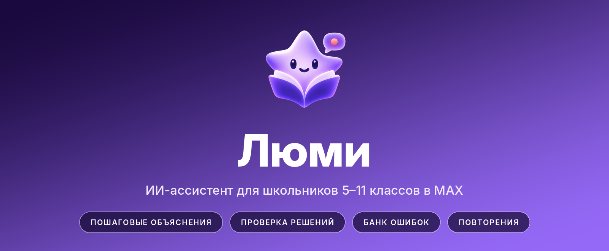
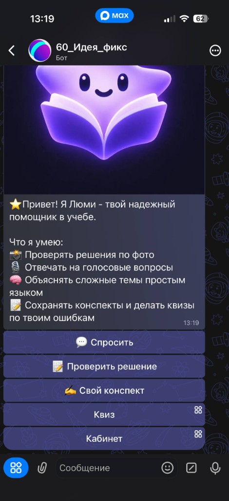
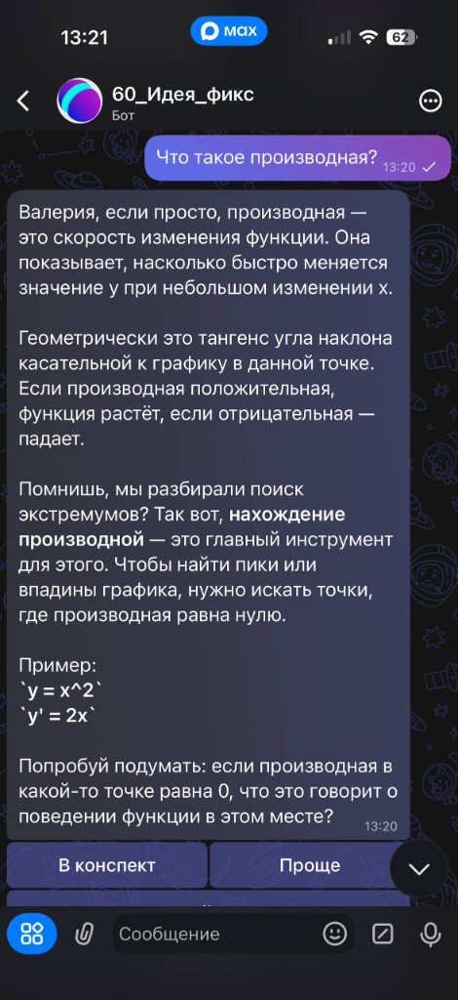
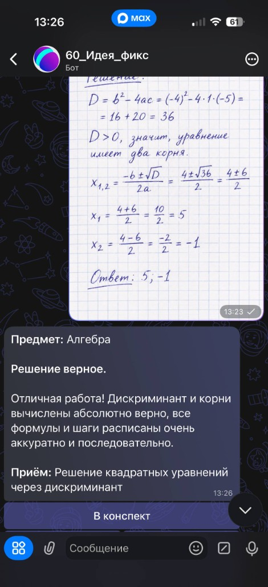
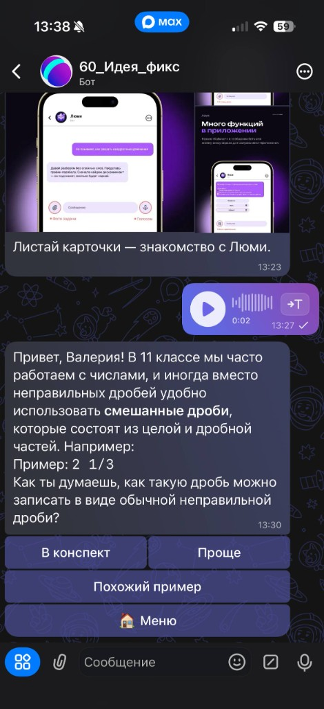
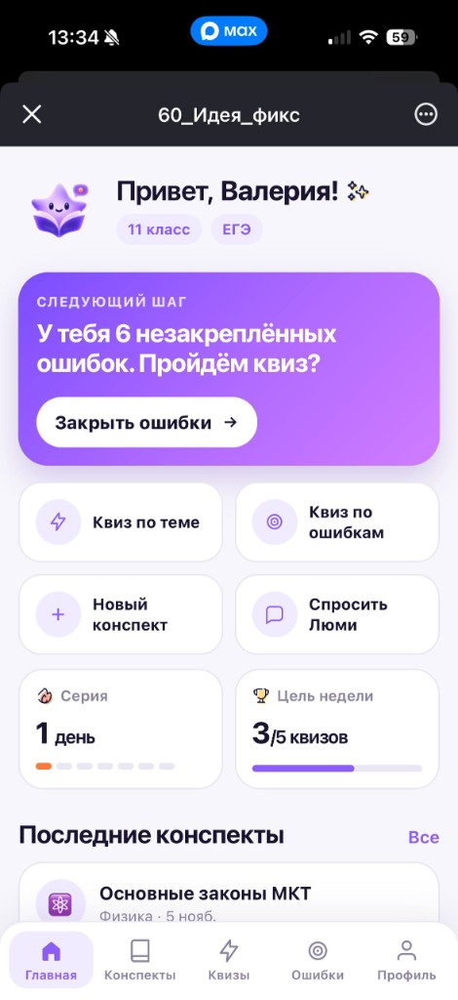
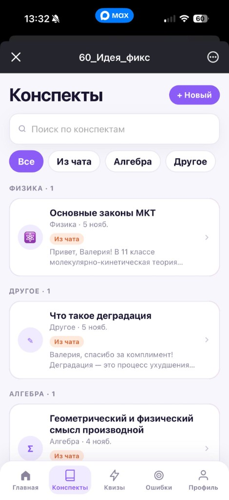
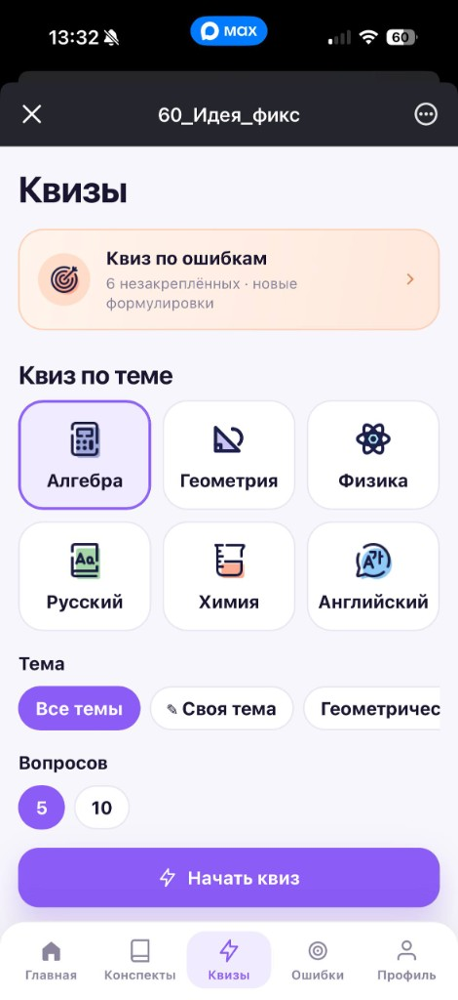
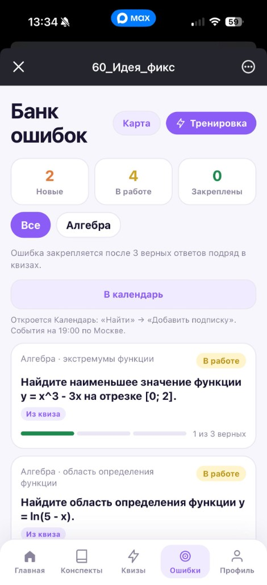

<div align="center">



<br>

[](https://www.python.org/)
[](https://fastapi.tiangolo.com/)
[](https://ai.google.dev/)
[](https://www.sqlite.org/fts5.html)
[](https://www.docker.com/)
[](LICENSE)

<br>

**Бот:** [max.ru/ideya_fiks_60_bot](https://max.ru/ideya_fiks_60_bot) · **Демо:** [lumi.it-cube32.ru/demo](https://lumi.it-cube32.ru/demo)

</div>

---

| Обучающий формат | Проверка решений | Банк ошибок | Интервальные повторения |
|:--|:--|:--|:--|
| Подсказка и наводящий вопрос вместо готового ответа | Определяет шаг с ошибкой по фото тетради | Накопление ошибок и квизы на их основе | Напоминания и события в календаре |

---

## Содержание

- [Назначение](#назначение)
- [Скриншоты](#скриншоты)
- [Возможности](#возможности)
- [Методика повторений](#методика-повторений)
- [Архитектура](#архитектура)
- [Целевая аудитория](#целевая-аудитория)
- [Отличия от универсальных ИИ-ассистентов](#отличия-от-универсальных-ии-ассистентов)
- [Технологический стек](#технологический-стек)
- [Структура репозитория](#структура-репозитория)
- [Установка и запуск](#установка-и-запуск)
- [Конфигурация](#конфигурация)
- [Надёжность и безопасность](#надёжность-и-безопасность)
- [Лицензия](#лицензия)

---

## Назначение

Люми работает внутри мессенджера **MAX** и помогает школьнику разобраться в теме, найти ошибку в решении и закрепить материал. Установка отдельного приложения не требуется: основной сценарий проходит в чате, а для квизов, конспектов и банка ошибок используется мини-приложение «Кабинет».

**Проблемы, на которые направлен сервис**

- Готовые ответы вместо понимания: ученик списывает решение и не усваивает приём.
- Повторяющиеся ошибки: после проверки к теме никто не возвращается.
- Разрозненные материалы: разборы остаются в переписке и не доступны к экзамену.

**Принципы работы**

1. Ответ не выдаётся сразу: ассистент даёт шаги, подсказку и наводящий вопрос. Полное решение доступно по запросу.
2. Проверка решений указывает конкретный шаг с ошибкой и связанный с ним учебный приём.
3. Ошибки сохраняются в банке, и на их основе формируются новые квизы с другими условиями.
4. Повторение материала планируется по интервальной методике, с напоминаниями и событиями в календаре.

---

## Скриншоты

<table>
  <tr>
    <td align="center" width="25%"><br><sub>Приветствие и меню</sub></td>
    <td align="center" width="25%"><br><sub>Объяснение по шагам</sub></td>
    <td align="center" width="25%"><br><sub>Проверка решения по фото</sub></td>
    <td align="center" width="25%"><br><sub>Голосовой вопрос</sub></td>
  </tr>
  <tr>
    <td align="center"><br><sub>Кабинет: главная</sub></td>
    <td align="center"><br><sub>Конспекты и поиск</sub></td>
    <td align="center"><br><sub>Квиз</sub></td>
    <td align="center"><br><sub>Банк ошибок</sub></td>
  </tr>
</table>

---

## Возможности

### Чат-бот в MAX

| Функция | Описание |
|---|---|
| Пошаговые объяснения | Короткие ответы простым языком: шаги, подсказка, вопрос. Итоговый ответ скрыт до нажатия «Показать решение» |
| Голосовые вопросы | Расшифровка голосового сообщения и ответ как на текстовый вопрос |
| Проверка решений | Фото тетради или текст. Определяет шаг с ошибкой, даёт подсказку без готового ответа; при верном решении отмечает, что сделано правильно |
| «Проще» и «Похожий пример» | Краткий пересказ разбора или новая задача на тот же приём с другими числами |
| Конспекты | Сохранение любого ответа кнопкой «В конспект», создание собственных конспектов |
| Поиск | Полнотекстовый поиск (SQLite FTS5) и поиск по смыслу средствами ИИ |
| Персонализация | Класс (5–11) и стиль объяснений («Короче» / «Подробнее») учитываются в ответах |
| Предметы | Алгебра, геометрия, физика, русский язык, химия, английский, биология, история, литература, обществознание, информатика, география |

### Мини-приложение «Кабинет»

| Раздел | Содержание |
|---|---|
| Главная | Рекомендуемый следующий шаг, серия занятий, цель недели (по умолчанию 5 квизов), последние конспекты |
| Конспекты | Список, поиск, создание, редактирование, закрепление, удаление; квиз по выбранному конспекту |
| Квизы | По предмету или произвольной теме, 5 или 10 вопросов, пояснение после каждого ответа. Сложность определяется классом, формат ОГЭ/ЕГЭ — целью |
| Банк ошибок | Статусы «Новые», «В работе», «Закреплены», фильтры и тренировка. Ошибка считается закреплённой после трёх верных ответов подряд |
| Календарь | Подписка в формате `.ics`: события на 19:00 по московскому времени по ошибкам и навыкам, требующим повторения |
| Профиль | Класс, цель (ОГЭ, ЕГЭ, самостоятельное изучение), стиль объяснений, напоминания, статистика и достижения |

### Напоминания

Не чаще одного раза в сутки и только с 9:00 до 21:00 по московскому времени ассистент уведомляет об ошибках, не закреплённых в банке. Напоминания отключаются в профиле.

---

## Методика повторений

Для каждого учебного приёма (например, «деление дробей») хранится уровень освоения и номер «коробки» в системе интервальных повторений (метод Лейтнера). Верный ответ переводит приём в следующую коробку, ошибка возвращает в первую.

| Коробка | 1 | 2 | 3 | 4 | 5 |
|---|:-:|:-:|:-:|:-:|:-:|
| Интервал до повторения, дней | 1 | 2 | 4 | 8 | 16 |

Актуальность навыка снижается со временем по кривой забывания. Приёмы, которые давно не повторялись, попадают в напоминания и календарь в первую очередь.

---

## Архитектура

```text
 MAX
 ├─ Чат с ботом ────────┐
 └─ Мини-приложение ────┤
                        ▼
        ┌──────────────────────────────────┐
        │  Сервис Люми (Python 3.12)       │       ┌──────────────┐
        │  Бот (maxapi) · API (FastAPI)    │◄─────►│  Gemini API  │
        │  Сервисы: репетитор, квизы,      │       │ текст·фото·  │
        │  конспекты, навыки, напоминания  │       │ голос        │
        └───────────────┬──────────────────┘       └──────────────┘
                        ▼
                 SQLite + FTS5
```

Бот, веб-кабинет, REST API и планировщик напоминаний запускаются одним процессом из `app/main.py`. Если `MAX_BOT_TOKEN` не задан, запускается только кабинет. Бот работает в режиме long polling или через HTTPS-вебхук.

---

## Целевая аудитория

Школьники 5–11 классов, которым нужна оперативная помощь с учёбой в привычном мессенджере.

| Группа | Потребность | Что предоставляет сервис |
|---|---|---|
| 5–8 классы | Понять тему и получить объяснение простыми словами | Краткие объяснения, голосовые вопросы, стиль «Короче» |
| 9 класс (ОГЭ) | Системная подготовка, закрытие пробелов | Квизы в формате ОГЭ, банк ошибок |
| 10–11 классы (ЕГЭ) | Практика и работа над ошибками | Квизы в формате ЕГЭ, интервальные повторения, календарь |

| Потребность | Решение |
|---|---|
| Разобраться в теме без лишних вопросов | Объяснения в чате в любое время |
| Понять, где в решении ошибка | Проверка по фото с указанием шага и приёма |
| Не списывать готовые ответы | Подсказки вместо решения, решение — по запросу |
| Не забывать пройденное | Интервальные повторения, напоминания, календарь |
| Держать материалы в одном месте | Конспекты с поиском и квизами по каждому из них |
| Сохранять регулярность занятий | Серия, цель недели, достижения |

---

## Отличия от универсальных ИИ-ассистентов

- **Обучающий формат ответа.** Подсказка и наводящий вопрос вместо готового решения; полный разбор по запросу.
- **Проверка именно решения ученика.** Определяется шаг с ошибкой по фото тетради, задача не решается заново.
- **Накопление ошибок.** Банк ошибок служит основой для новых квизов: генерируются другие задачи на те же приёмы.
- **Планирование повторений.** Интервальные повторения, напоминания и события в календаре.
- **Учёт профиля ученика.** Класс, цель (ОГЭ, ЕГЭ, самостоятельное изучение), стиль объяснений.
- **Интеграция с MAX.** Чат, голосовые, фото и мини-приложение в одном месте.

---

## Технологический стек

<div align="center">

</div>

| Слой | Технологии | Назначение |
|---|---|---|
| Бот | `maxapi` 1.2.3 | Клиент MAX Bot API: сообщения, кнопки, мини-приложение, вебхуки |
| Бэкенд | Python 3.12, FastAPI, Uvicorn, asyncio | Единый асинхронный процесс: бот, REST API, напоминания |
| ИИ | `google-genai` (Gemini API) | Объяснения, проверка по фото, расшифровка голоса, генерация квизов, поиск по смыслу |
| Хранилище | SQLite, `aiosqlite`, FTS5 | Пользователи, конспекты, ошибки, квизы, навыки; полнотекстовый поиск |
| Конфигурация | `pydantic-settings` | Настройки из `.env`, валидация вебхука и прокси |
| Фронтенд | HTML, CSS, JavaScript | Мини-приложение без сборки и фреймворков |
| Сеть | `socksio` | Доступ к Gemini API через SOCKS5-прокси |
| Развёртывание | Docker, Docker Compose | Запуск одной командой, healthcheck, том для базы данных |

Промпты вынесены в отдельные файлы (`app/prompts/*.txt`). Ответы модели приходят в формате JSON. При недоступности основной модели сервис автоматически переключается на резервные (`GEMINI_FALLBACK_MODEL`).

---

## Структура репозитория

```text
Hackaton_60/
├── app/
│   ├── main.py              # Точка входа: бот, кабинет, напоминания
│   ├── config.py            # Настройки и их валидация
│   ├── db.py                # SQLite: схема, FTS5, запросы
│   ├── web.py               # FastAPI: кабинет и REST API
│   ├── webapp.py            # Проверка подписи запуска мини-приложения MAX
│   ├── textutil.py          # Форматирование, нормализация, поиск
│   ├── cabinet.html         # Мини-приложение «Кабинет»
│   ├── bot/                 # Обработчики, клавиатуры, команды, рендер ответов
│   ├── services/
│   │   ├── tutor.py         # Работа с Gemini: ответ, проверка, голос, квиз
│   │   ├── quiz.py          # Квизы по теме, конспекту и ошибкам
│   │   ├── notes.py         # Конспекты, поиск, профиль ученика
│   │   ├── skills.py        # Интервальные повторения
│   │   ├── reminders.py     # Напоминания, «тихие часы»
│   │   ├── calendar_export.py
│   │   └── limits.py        # Ограничение частоты запросов
│   ├── prompts/             # Промпты ассистента
│   ├── static/              # CSS, JS, иконки кабинета
│   └── assets/              # Логотип и графические материалы
├── scripts/seed_demo.py     # Демонстрационные данные
├── tests/test_core.py       # Автотесты
├── docs/screenshots/        # Скриншоты для README
├── Dockerfile
├── docker-compose.yml
├── requirements.txt
└── .env.example
```

---

## Установка и запуск

### Требования

- токен бота MAX (`MAX_BOT_TOKEN`);
- ключ Gemini API (`GEMINI_API_KEY`);
- Docker и Docker Compose либо Python 3.12.

### Docker

```bash
git clone https://github.com/Mistyowl/Hackaton_60.git
cd Hackaton_60

cp .env.example .env        # укажите MAX_BOT_TOKEN и GEMINI_API_KEY
docker compose up -d --build
```

Кабинет: <http://localhost:8000>. Проверка состояния: <http://localhost:8000/health>.

### Локальный запуск

```bash
git clone https://github.com/Mistyowl/Hackaton_60.git
cd Hackaton_60

python -m venv .venv
source .venv/bin/activate        # Windows: .venv\Scripts\activate
pip install -r requirements.txt

cp .env.example .env             # укажите токены
python -m app.main
```

Без `MAX_BOT_TOKEN` запускается только веб-кабинет. Без `GEMINI_API_KEY` функции ИИ сообщают о необходимости добавить ключ.

### Демонстрационные данные

```bash
python -m scripts.seed_demo <user_id_в_MAX>
```

### Тесты

```bash
python -m unittest tests.test_core -v
```

---

## Конфигурация

| Переменная | Назначение |
|---|---|
| `MAX_BOT_TOKEN` | Токен бота MAX |
| `GEMINI_API_KEY` | Ключ Gemini API |
| `GEMINI_MODEL` | Основная модель |
| `GEMINI_FALLBACK_MODEL` | Резервные модели через запятую |
| `DATABASE_PATH` | Путь к базе SQLite (по умолчанию `data/tutor.db`) |
| `WEB_HOST`, `WEB_PORT` | Адрес и порт кабинета (по умолчанию `127.0.0.1:8000`) |
| `CABINET_URL` | Публичный адрес кабинета |
| `MAX_WEBHOOK_URL`, `MAX_WEBHOOK_SECRET` | HTTPS-вебхук на порту 443. Если не задан — long polling |
| `PROXY_HOST`, `PROXY_PORT`, `PROXY_USERNAME`, `PROXY_PASSWORD` | SOCKS5-прокси для запросов к Gemini API |
| `ALLOWED_USER_IDS` | Список идентификаторов MAX через запятую. Если пусто — доступ открыт всем |
| `WEEK_QUIZ_GOAL` | Цель недели в квизах (1–50, по умолчанию 5) |

---

## Надёжность и безопасность

| Мера | Результат |
|---|---|
| Проверка подписи запуска мини-приложения (HMAC-SHA256 по токену бота, ограничение возраста данных) | Кабинет доступен только аутентифицированным пользователям MAX |
| Ограничение частоты запросов: 30 в час на пользователя | Защита от злоупотреблений и перерасхода квоты ИИ |
| Белый список пользователей (`ALLOWED_USER_IDS`) | Закрытое тестирование на выбранной группе |
| Резервные модели ИИ | Сервис отвечает при недоступности основной модели |
| SOCKS5-прокси для Gemini API | Работа в сетях с ограничениями |
| Режим вебхука с секретом | Корректный приём голосовых сообщений, которые в режиме polling иногда приходят пустыми |
| «Тихие часы» 21:00–09:00 МСК | Напоминания не отправляются ночью; отключаются в профиле |
| Healthcheck `/health`, `restart: unless-stopped` | Автоматический перезапуск контейнера при сбое |
| Секреты в `.env`, файл исключён из репозитория | Токены и ключи не попадают в систему контроля версий |
| Экранирование вывода ИИ, запрет HTML и ссылок в промптах | Защита от внедрения разметки в сообщения |

---

## Лицензия

Проект распространяется под лицензией MIT. Подробности в файле [LICENSE](LICENSE).
